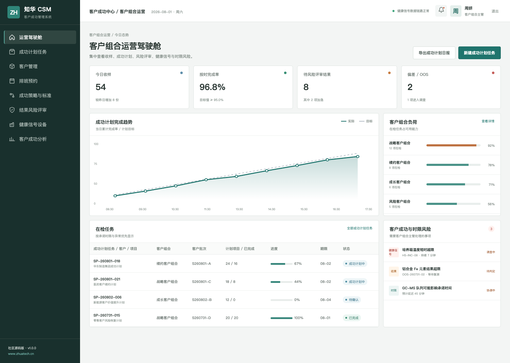
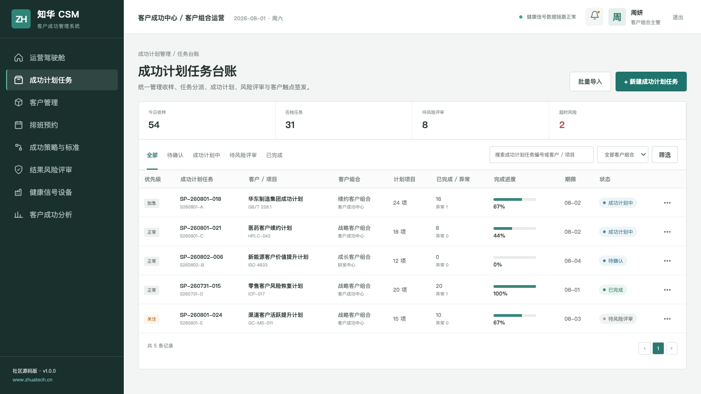
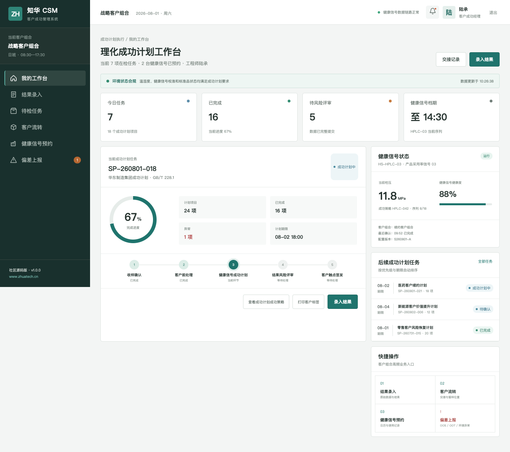

[简体中文](README.md) | **English**

## 2026-10-23 update: Recurring-revenue retention bridge

Separates retained expansion, contraction, churn and new customer revenue when calculating NRR and GRR, excluding new customers from the existing-cohort retention numerator.

After signing in to the real backend, open the bottom-right business calculation tool to submit structured input, inspect calculated results and export complete JSON. The endpoint is `POST /api/workbench/revenue-retention-bridge` with the existing JWT. Computation is implemented server-side; it does not query another user's records, persist business documents, approve transactions or invoke external models. See [algorithm, sample and test notes](docs/AI_WORKFLOW_UPGRADE_20261023.md).

# ZhuaTech Customer Success Management

> A source-available enterprise project by [ZhuaTech](https://www.zhuatech.cn/) for customer, sales, marketing, channel, and service operations.

ZhuaTech Customer Success Management provides a practical, self-hosted foundation for customer, sales, marketing, channel, and service operations. It is designed for sales, marketing, customer-success, service, and channel teams, with clear business records, controlled workflows, operational visibility, and auditable actions.

This repository is intended for learning, technical evaluation, and non-commercial collaboration. The included implementation, tests, database resources, and container configuration provide a reproducible starting point for further enterprise adaptation.

**Search topics:** enterprise customer success management, self-hosted customer success management, Java Spring Boot enterprise software, digital transformation.

## Enterprise Use

- **Primary users:** Sales, marketing, customer-success, service, and channel teams.
- **Deployment model:** Self-hosted, with container-based local deployment where supported.
- **Governance baseline:** Role-aware operations, validation, approval boundaries, exception handling, and auditability.
- **Production boundary:** Review security, identity, backup, observability, capacity, and compliance controls before production use.

## Core Capabilities

- **Customer Portfolio** — Manage customer portfolio with ownership, validation, and explicit lifecycle states.
- **User** — Coordinate user through controlled workflows and approval gates.
- **Success Plan** — Track success plan metrics, exceptions, deadlines, and follow-up actions.
- **Touchpoint Record** — Preserve touchpoint record evidence in searchable, traceable operational history.
- **Risk Review** — Expose risk review in role-aware user and administration workspaces.
- **Health Signal** — Connect health signal to external systems through configurable integration boundaries.

## Architecture and Runtime

**Technology stack:** Java 21 · Spring Boot · Vue 3 · Vite · MySQL 8 · Docker Compose

### Repository Layout

- `backend/` — Java backend, domain services, APIs, validation, and automated tests
- `frontend/` — responsive user and administration interfaces
- `deploy/` — deployment and operations resources
- `docs/` — architecture, operations, screenshots, and supporting documentation
- `compose.yaml` — local multi-service orchestration

## Quick Start

```bash
docker compose up -d --build
```

- Review `compose.yaml` before changing published ports, storage paths, or production credentials.

## Verification

Run the checks supported by this repository before changing or deploying it:

```bash
cd backend && mvn test
cd frontend && npm ci && npm run build
```

## Interface Preview

### Csm Success Dashboard



### Csm Plan Register



### Csm Manager Workbench



## Security and Production Readiness

- Never commit real passwords, API keys, tokens, certificates, customer data, or production connection strings.
- Replace all local demonstration credentials and secrets before deployment.
- Apply least privilege, tenant isolation, backup and restore drills, monitoring, rate limiting, and vulnerability management.
- Please report security issues privately through the contact channels below instead of publishing sensitive details.

## Usage and Commercial Licensing

Copyright © 2026 Shanghai Rujing Zhihua Information Technology Co., Ltd.

This project is a publicly available source edition intended solely for personal learning, technical research, and non-commercial communication. Commercial use, paid delivery, resale, hosted commercial services, and commercial derivative distribution require prior written authorization from the copyright holder.

Third-party dependencies remain subject to their respective licenses. Review the repository `LICENSE` and `NOTICE` files before use.

## Commercial Licensing and Enterprise Services

For commercial licensing, private deployment, enterprise customization, software outsourcing, implementation services, FDE outsourcing, OPC technical support, or AI transformation consulting, contact ZhuaTech:

- Email: [han@zhuatech.cn](mailto:han@zhuatech.cn)
- Email: [jack@zhuatech.cn](mailto:jack@zhuatech.cn)
- [WhatsApp: +86 17521234993](https://wa.me/8617521234993)
- Website: [https://www.zhuatech.cn/](https://www.zhuatech.cn/)

## About ZhuaTech

[ZhuaTech](https://www.zhuatech.cn/) is operated by Shanghai Rujing Zhihua Information Technology Co., Ltd. We support small and medium-sized enterprises with digital transformation, AI adoption, enterprise software implementation, custom development, software project outsourcing, FDE services, OPC integration, and long-term technical support.
